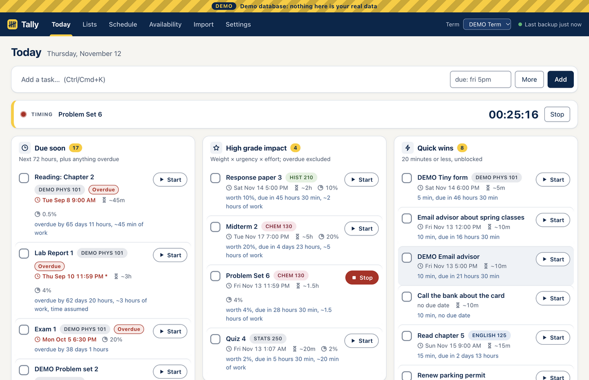
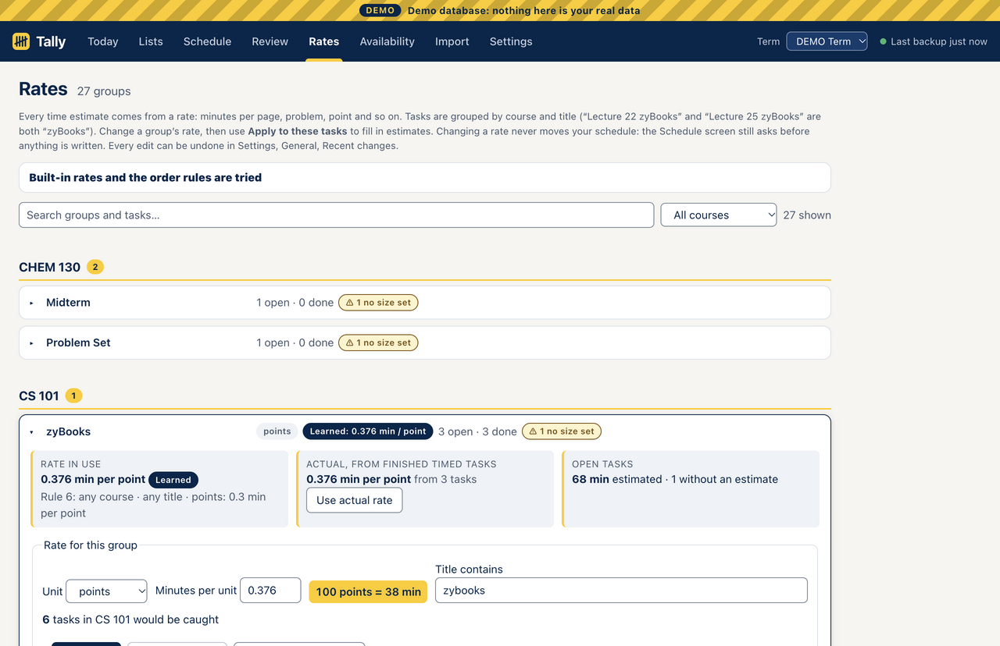

# Tally

Personal to-do and planner for a university student. Electron desktop app (Phase 5) on its own SQLite database. No LLM calls and no API keys: Claude extracts syllabi separately into JSON files (see `docs/IMPORT_FORMAT.md`), and the app only imports them. Google Calendar (Phase 3) is the only external service.

**Installing on a Mac?** See the [install guide](docs/INSTALL.md) (Apple silicon, macOS 13 or later). Want Google Calendar? See the [Google setup guide](docs/GOOGLE_SETUP.md).

## Screenshots
Both screenshots use the built-in demo database (note the DEMO banner): every course and task is made up.





## Status
All five phases are complete: import + review/diff, a full CLI to-do app, Google Calendar scheduling, dependencies and views, and the Electron desktop app (screens, global quick-add shortcut, notifications, menu-bar timer, packaged macOS app). See `CLAUDE.md` for the decisions.

## Setup
```
npm install
node node_modules/electron/install.js   # npm 11 blocks the Electron download script; run once
npm test
npm run verify:native                   # better-sqlite3 under Node and Electron
```

## Try it (demo data, never touches real data)
```
npm run demo                                           # rebuild demo.db and print it
npm run import -- samples/math-101.json --demo         # review, then type: a
npm run import -- samples/math-101.json --demo --yes   # re-run: 0 added (no duplicates)
npm run import -- samples/math-101-revised.json --demo # shows new / changed / unchanged / missing
npm run import -- samples/invalid.json                 # readable errors
npm run show -- --demo
```
Real import: `npm run import -- imports/<file>.json`. Databases live in `~/Library/Application Support/todo-planner/` (`planner.db`, `demo.db`); override with `PLANNER_DB` / `PLANNER_DEMO_DB`.

`imports/` is gitignored (your coursework); `samples/` is committed and fake.

## Using the CLI (Phase 2)
Short aliases: `a` add, `d` done, `l` ls, `s` search (e.g. `npm run plan -- l`). `ls` is a daily view: OVERDUE / TODAY / UPCOMING / NO DUE DATE. `npm run plan -- doctor` checks your setup (database, backups, term, timezone).
All commands: `npm run plan -- help`. Add `--demo` to any command to use the demo database (`npm run seed` rebuilds it).
```
npm run plan -- term new "My Term" --start 2026-08-31 --end 2026-12-11    # first term becomes current
npm run plan -- list new Math
npm run plan -- add "Read ch. 3" --due fri 5pm --list Math --est 45
npm run plan -- add "Problem set" --course "MATH 101" --type homework --due sun        # no time => 11:59 PM, shown with *
npm run plan -- add "Weekly review" --due sun 9am --repeat weekly
npm run plan -- ls                          # current term + term-less tasks; --term X / --all-terms to change
npm run plan -- ls --by course              # group imported tasks by course
npm run plan -- done 3 | undone 3 | rm 3 | undo        # rm is a soft delete
npm run plan -- search chapter
npm run timer 3                             # any key stops; records a session, sets actual minutes
npm run plan -- multipliers                 # e.g. homework 1.44x (applied to hints after 3 samples)
npm run plan -- term archive "Old Term"     # hides it from default views; data is kept
```
**Data safety:** an automatic verified backup is made once a day (keeping 14) when you run any `plan` command. Point backups at a cloud-synced folder so a lost laptop doesn't lose your tasks:
```
npm run plan -- config set backup_folder "$HOME/Library/Mobile Documents/com~apple~CloudDocs/planner-backups"
npm run backup        # on demand, verified    |  npm run plan -- backups   # list + integrity status
npm run export        # JSON + .ics of everything
npm run restore       # lists backups; `npm run restore <file>` asks for confirmation and saves a pre-restore copy
```
Settings: `npm run plan -- config` / `config set timezone America/Detroit` / `config set default_due_time 23:59`.

## Scheduling and Google Calendar (Phase 3)
Setup (one time): create a Google Cloud project + Desktop OAuth client on your personal account, save the JSON as `~/Library/Application Support/todo-planner/google-client.json`, then:
```
npm run plan -- calendar connect        # opens your browser; token goes to the macOS Keychain
npm run plan -- calendar list           # find your class calendar ids
npm run plan -- calendar busy           # the busy blocks the scheduler sees (flags all-day events)
npm run plan -- calendar classes        # which block counts as each day's first class, and what was ignored
npm run plan -- config set class_calendars <id>
npm run plan -- config set working_hours @samples/working-hours.json     # your routine: ONLY used as input for the next line
npm run plan -- availability seed       # turns that routine + your real class calendar into editable free windows (next 4 weeks + a weekly template)
npm run plan -- availability show --week            # see / edit them: availability set mon 09:00-17:00 | set 2026-11-14 13:00-18:00 blocked | clear <date> | copy-week <from> <to>
npm run schedule                        # DRY RUN: prints the next 7 days
npm run schedule -- --apply             # writes to the "Planner Blocks" calendar only
npm run replan                          # dry run: missed blocks re-placed in the next free slots
npm run plan -- away add 2026-11-14               # block a date (away add <date> 16:00-18:00 for a window; away rm / away ls)
```
Try it without Google: `npm run seed`, then `npm run schedule -- --demo` (simulated classes). Preview your real tasks against simulated classes: `npm run schedule -- --fake-calendar`.
Work starts early by default (`config set placement_style late` for the old as-late-as-possible behaviour); free time is only what you select in `availability`; estimates can come from task size (`edit <id> --size 12 pages`, `ls --needs-size`, `estimates`). Units: pages, video_minutes, problems, items and **points** (e.g. zyBooks: `edit <id> --size 100 points`, default 0.3 minutes per point, so 100 points = 30 min and 40 points = 12 min, never below 5). Set a rate for one course and title pattern, decimals allowed: `npm run plan -- rates set 0.3 --unit points --course "EECS 183" --match zyBooks` (`rates` lists them, `rates rm <n>` removes one). A manual estimate always wins; the timer's logged time on finished zyBooks tasks calibrates the points rate after 3 samples. Details: `CLAUDE.md`.
Google "Testing" mode tokens expire after 7 days; the app tells you to run `calendar connect` again.

## Bring your own Google client
Tally talks to Google Calendar only if you set it up yourself. The repository does **not** include a Google OAuth client, and it never will: you need your own `google-client.json` from your own Google Cloud project.

1. In the Google Cloud console, create a project, enable the Google Calendar API, and create an OAuth client of type **Desktop app**.
2. Download its JSON. In the app, open **Settings > Google > Set up Google Calendar** and press **Choose client file…**: Tally checks that it is a Desktop-app client and saves it (mode 600) as `~/Library/Application Support/todo-planner/google-client.json`, outside the repo. It shows only the last characters of the client ID and never the secret. (By hand also works: save the JSON there yourself. `google-client.json` is in `.gitignore`, and `tests/noClientSecret.test.ts` fails if a client file or secret ever gets into the repository or a build.)
3. Press **Connect** in the same panel, or run `npm run plan -- calendar connect`. Your sign-in token is stored only in the macOS Keychain, never in a file.

Without a client file the app still works fully on its own (tasks, lists, estimates, the Availability grid and the scheduler, which then plan from your free windows alone, with no errors or reconnect prompts); only writing blocks to a calendar stays off (Apply says so). The step-by-step guide is [docs/GOOGLE_SETUP.md](docs/GOOGLE_SETUP.md). None of the author's data is included in this repository: there is no database, no calendar, no tokens and no real task data. The demo database, the samples in `samples/` and every test use made-up courses and tasks. Your own data lives in `~/Library/Application Support/todo-planner/` on your machine.

## Dependencies, plans, views (Phase 4)
```
npm run plan -- dep add 12 7           # task 12 is blocked by task 7 (cycles refused; blocked tasks are not scheduled)
npm run plan -- dep ls
npm run import -- imports/exam2-plan.json      # a plan: steps for an exam/project with depends_on (see docs/IMPORT_FORMAT.md)
npm run views                          # Due Soon, High Grade Impact (pending), Quick Wins, Blocked
```

## The app (Phase 5, in progress)
```
npm run dev:demo      # open the app on the DEMO database (safe to click around)
npm run dev           # the app on your real database
npm run smoke         # headless-ish check: loads the screen, prints what rendered
```
Quick-add understands dates at the end of the title (`written homework due friday 5pm`, `read ch 3 fri`, `call mom tonight`) and shows what it parsed as you type. So far: **Today** (four computed views + quick-add + timers), **Lists** (drag to reorder), the **task detail** drawer (click any task title), **Availability** (weekly grid), **Schedule** (preview, then confirm before Apply or Replan writes anything) **Import** (choose or drop a JSON file, review the diff, confirm) and **Settings** (time zone, scheduling and priority numbers, terms with an archived-terms browser, Google connection, backups and restore). `npm run smoke:ui` drives the UI on the demo database as an automated check. Also done: the global quick-add shortcut (Cmd/Ctrl+Shift+Space) and desktop notifications (Settings, Notifications). Also: a menu-bar icon with the running timer (closing the window hides it there; quit from its menu). The packaged build is done (below).

## Pinning a block by hand
On the **Availability** grid, drag any Tally block (written ■ or proposed ◇) to another time to **pin** it there (📌), or drag its bottom edge to change its length (within the shortest/longest block settings). On the **Schedule** screen each block has **📌 Pin…** (type a day and times). A pinned block is kept by every later Schedule and Replan: the planner treats it as fixed busy time for other tasks, never moves or removes it, counts its minutes toward its task, and Apply writes it at that time. A drop on a class, the gym or other busy time, another block or pin, an exam, blocked availability or time outside your availability is refused in plain words, with the places it would fit. Click a pinned block for **Unpin** (it stays on the calendar until the next Apply) or **Move back to automatic** (the preview shows where the planner puts it). If the task is done or its due date moves before the pin, the Schedule screen warns instead of silently keeping it.

## Rates (every time estimate, customizable)
The **Rates** tab groups every task by course and title stem (“Lecture 22 zyBooks” and “Lecture 25 zyBooks” are both “zyBooks”; “Smith-Jones reading wk 4” is “Smith-Jones reading”). Each group is one rate rule: pick the **unit** (pages, video_minutes, problems, items, points) and **minutes per unit** (decimals fine; a live example such as “100 points = 45 min” updates as you type) and the **title text** it applies to (with a preview of the tasks it would catch). It also shows the rate in use (Your rate, Built-in default or Learned), the rate actually measured from finished timed tasks (“not enough data” under 3; **Use actual rate** copies it into the field, never applies it by itself), the open tasks' total estimate, and the learned timing multiplier for the group (with an on/off switch and Reset). **Apply to these tasks…** lists exactly which tasks change (before and after) and writes nothing until you confirm; manual estimates are kept unless you tick “also replace manual estimates”. You can rename, merge, split out and move tasks between groups; that is remembered (it survives imports). At the top, the built-in rates and the 5-minute points minimum are editable and the order the rules are tried in is shown (first match wins: yours, then built-in); a task's detail shows “Why this estimate”. Every edit appears under Settings, General, Recent changes and can be undone. Changing a rate never applies a schedule. Each group has a **mode**: **Per unit** (minutes per page, point, problem… times the task's size, as before), **Per assignment** (a flat number of minutes for every task in the group; the task needs no size or unit; the example reads “any task in this group = 60 min”; the group shows the measured average minutes per finished timed task, “not enough data” under 3, and **Use average** fills the field without saving it) or **No rate** (the group never gets a flat or size-based estimate; a manual estimate still counts). Per task: manual estimate > flat per-assignment rate > size-based rate > none; flat estimates never get the learned multiplier; Apply to these tasks works the same (before/after, manual kept unless ticked, confirm above 3). Switching modes keeps the group's name, merge, multiplier switch and its per-unit rate. From the terminal: `npm run plan -- rates set 60 --per-assignment --course "EECS 183" --match Lab`. **Regroup** (top of the screen) recomputes the automatic groups from the titles and reports what moved; your renames, merges, splits and moves follow their tasks, and saved rates (including their match text) are never touched. A group's name is the title with the subtitle (after the first colon or a spaced dash), numbering (“#6”, “No. 3”, “Part II”, “Week 9”, “Lecture 22”), dates and parenthetical text removed, with case and accents folded: “Video Discussion Post 4: Sample Subtitle” and “Video Discussion Post 5: Second Sample Subtitle…” are one group, “Final Project Phase Two Part III: …” is “final project phase two” (separate from “Final Project Presentation” unless you merge them). (`npm run plan -- rates` still works from the terminal.)

## Weekly review
The **Review** tab walks through four steps and remembers the date of your last review; a marker (**!**) shows on the tab once a week has passed. (1) **What you finished**: planned blocks that have passed and things that came due since the last review, each answered Done, Partly (logs the minutes) or Not done. (2) **Overdue and slipped**: Reschedule due, Mark done, Drop (a soft delete) or Keep. (3) **Missing details**: tasks due within 14 days with no estimate, no size or an assumed due time, with a field to fix each. (4) **Replan**: the 14-day replan preview, then the normal Apply confirmation. Nothing is written until you press a step's button; each step is one entry in the change history (Settings, General, Recent changes) with Undo. Claude can read the review (`get_review`) but cannot answer or finish it.

## Capture from your phone
Add reminders on your iPhone to an Apple Reminders list named **Tally Inbox**; while Tally is open it turns each open reminder into a task, then marks the reminder completed (never deleted). Settings, Phone has the switch, the list name, the macOS permission status and **Check now**; Today has an **Inbox** panel with Undo. Steps and troubleshooting: [docs/PHONE_CAPTURE.md](docs/PHONE_CAPTURE.md).

## Google sign-in expired every week?
A Google Cloud project in **Testing** mode expires every sign-in after 7 days. [docs/GOOGLE_PRODUCTION.md](docs/GOOGLE_PRODUCTION.md) has the click-by-click steps to move the project to **In production** as a personal, unverified app (scopes unchanged), what warning to expect on the next sign-in, and what can still revoke the sign-in. In the app: when Google rejects the saved sign-in, **Settings, Google**, the **Schedule** screen and a **banner** say exactly what happened with a one-click **Reconnect**; Settings, Google shows the sign-in's age and, when it is known the project is in Testing, a countdown to the 7-day limit. `npm run plan -- calendar status` shows the same from the terminal.

## Claude connector (MCP)
A local connector lets Claude (the desktop app or Claude Code) work with Tally. Reading is always allowed. Three switches in Settings, General, Claude connector are all **off** until you turn them on: **change my tasks** (add and edit tasks and lists, steps, dependencies, timers, log work, confirm an import), **delete tasks** (one at a time, undoable) and **apply schedules to Google** (Claude only *asks*; nothing is written until you click Approve on the Schedule screen). Every change is listed with an Undo button, and the last 50 connector calls are visible. When Claude files a schedule request, Tally shows a desktop notification and a banner ("Claude proposed a schedule: N blocks to write, M to remove. Review on the Schedule tab"); it can be switched off in Settings, Notifications. No LLM, no keys, no network port, and the connector never talks to Google. Setup, tools and examples: [docs/MCP.md](docs/MCP.md). Quick start: `npm run build:mcp`, `npm run mcp:config -- --demo` (prints the config for Claude desktop and Claude Code), `npm run smoke:mcp` (checks everything on the demo database). `npm run plan -- changes` lists what Claude changed; `changes undo <id>` undoes one.

## Install the packaged app (macOS, Apple Silicon)
```
npm run build            # builds release/mac-arm64/Tally.app (ad-hoc signed) and checks it
npm run install:app      # copies it to /Applications (quit Tally first); offers to remove the old Planner.app
open -a Tally            # or Launchpad / Spotlight: "Tally"
```
- It opens the same database and the same iCloud backup folder as `npm run dev` and the command line (`npm run verify:package` proves it, read-only).
- Closing the window hides it to the menu-bar icon (and the Dock icon shows a running timer); quit from the icon's menu or Cmd+Q.
- macOS asks about the Keychain the first time Google is used (Settings, Google, Check connection): choose **Always Allow**. It asks once per installed build; after a rebuild it asks once more. To be asked only once ever: `npm run make-signing-identity` (optional, adds a certificate to your login Keychain), then `PLANNER_SIGN_IDENTITY="Tally Local Signing" npm run build`.
- The first notification asks for permission: choose Allow. The packaged app has its own name, so it appears under System Settings, Notifications.
- Don't run `npm run dev` and the installed app on your real data at the same time (both would claim the global shortcut).
- `npm run smoke:package` drives the whole UI against the packaged app on the demo database.

## Rebuilding after you change the code
```
npm test && npm run typecheck
npm run build            # new release/mac-arm64/Tally.app, signed and checked
# quit Tally first (menu-bar icon, "Quit Tally", or Cmd+Q)
npm run install:app      # replaces /Applications/Tally.app
open -a Tally
```
Take a backup first if you changed anything about the database: `npm run backup`. After each rebuild macOS asks about the Keychain once more (Always Allow).

## Removing the old Planner app
Quit Planner (menu-bar icon, "Quit Planner"), then drag `/Applications/Planner.app` to the Trash, or run `rm -rf /Applications/Planner.app`. This deletes only the app; your data, backups and Google sign-in are not inside it. `npm run install:app` also offers to do it.

## The name
The app is called **Tally** (it was "Planner"). Only the product name changed: your data folder (`~/Library/Application Support/todo-planner`), `planner.db`, the iCloud backup folder, the Google client file, the Keychain entries, the settings and the "Planner Blocks" Google calendar keep their names, so nothing is orphaned. To remove the old app by hand: quit Planner (its menu-bar icon, "Quit Planner"), then drag `/Applications/Planner.app` to the Trash.

## Look and feel
Light and dark themes (Settings, General, Appearance: match the system, light or dark) and a **Color scheme** picker below it: eight presets (Blue and Maize is the default; Ocean, Forest, Crimson, Violet, Slate, Sunset, Graphite) or Custom (two color pickers plus hex fields). Each scheme is a primary and an accent color; Tally works out the full light and dark palettes from them and keeps every pair readable (text 4.5:1, controls 3:1, the accent only as a fill with readable text on it) by adjusting lightness. If custom colors cannot be made readable it says why and keeps your previous scheme. It is one setting (`color_scheme`: a preset id, or `{"primary":"#…","accent":"#…"}`) applied live to every window; Reset returns to the default. The app, menu-bar and Dock icons keep their fixed design. Course chip and status colors do not change (`src/app/colorScheme.ts`). Every text and control color pair, in every preset, in both themes, is checked for WCAG AA in `tests/contrast.test.ts`. Screenshots: `docs/ui/` (`node scripts/ui-shots.mjs <label> today` takes them on a scratch demo database).
