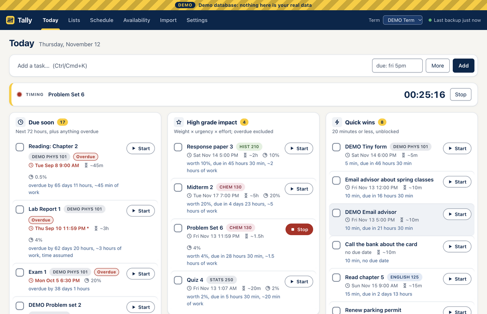
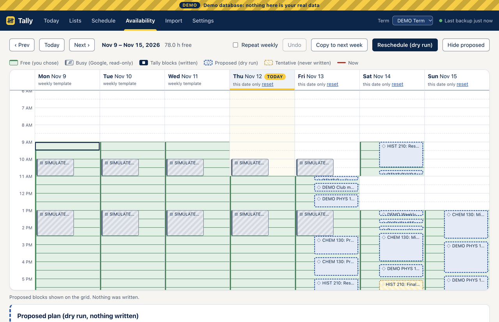
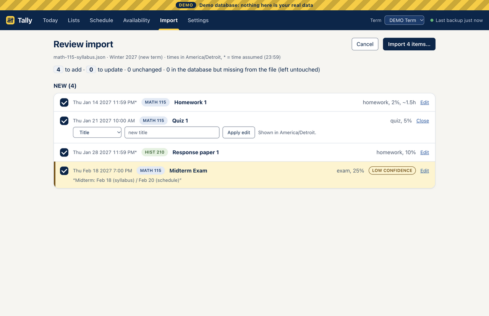
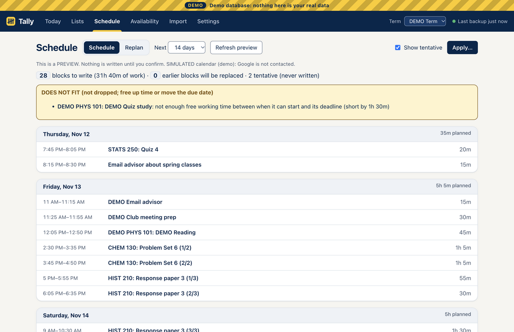

# Getting started with Tally

You have installed Tally (if not, see [INSTALL.md](INSTALL.md)). This page gets you from an empty app to a working plan.

## What Tally is
Tally is a local planner that fits your assignments into your real free time. Everything stays on your Mac, in its own database, and there is no AI inside it. (If you want an assistant to read a syllabus for you, you use your own and import its output; see "Getting tasks in".)



## Your first 10 minutes

**1. Create your term.** Open **Settings > Terms**, type a name such as "Fall 2026", pick the start and end dates, and click **Create term**. A term groups one semester's tasks. The first term you create becomes the *current* one (later ones need **Make current**, or the "Make it current" box). Tasks with a course attach to the current term, and Today, search and the scheduler show the current term (plus tasks with no course). When the semester is over, **Archive** it: nothing is deleted.

**2. Check the time zone.** **Settings > General > Time zone** (the default is America/Detroit). Enter yours, for example `America/Chicago`, and click **Save**. A due date with no time means 11:59 PM; you can change that on the same tab (**Default due time**).

**3. Paint your free hours.** Open the **Availability** tab. This grid is the source of truth for *when you can work*: Tally only plans inside the green free time.
- **Drag on empty time to paint** free hours. **Drag on green time to erase** it. (The first square you press decides which.)
- With **Repeat weekly** ticked, your edits change the weekly template (every Monday, and so on). With it off they change only the dates you see; those days then say "this date only" with a **reset** link.
- **Undo** (or Cmd+Z) reverses the last edit. **Copy to next week** copies this week's windows forward.
- Leave out meals, activities (gym, personal time, etc.), and sleep. Tally never places work outside the green.



**4. Optional: Google Calendar.** Not needed to start. Follow [GOOGLE_SETUP.md](GOOGLE_SETUP.md) when you want it. **With Google**, Tally also sees your busy times (free/busy only, never event titles) and, when you confirm, writes your planned blocks to its own **"Planner Blocks"** calendar; other calendars are never changed. **Without Google**, the Availability grid and the **Schedule** screen work the same and show the proposed plan, but nothing can be written to a calendar: on Schedule, a note says "Google Calendar is not set up, so this plan uses your Availability grid only", and the **Apply…** button is greyed out. You follow the plan from the screen.

## Getting tasks in

**Quick-add.** On **Today**, type in the top box and press Enter. A date at the end of the title is understood: `Read ch 3 due friday 5pm`, `Problem set due tomorrow`, `Lab report by 11/20`. Ctrl/Cmd+K jumps to the box. The **due:** box next to it wins if you fill it. **More** adds a list, a course (`CHEM 101`), an estimate in minutes, and a size with a unit. Click any task title to open its drawer: type (homework, exam, quiz, reading and so on), grade weight, notes, and more.

**From anywhere on your Mac:** press **Cmd+Shift+Space** for a small quick-add window (change it in **Settings > General > Quick-add shortcut**).

**Import a syllabus.** Tally has no AI. Give your syllabus and the prompt below to any assistant (Claude, ChatGPT, and so on), save its reply as a `.json` file, then open **Import**, drop the file on the page (or paste it under "Or paste the JSON"). You see every item before anything is written; uncheck what you don't want, use **Edit** to fix a title or date, then **Import N items…** and confirm. Low-confidence items are highlighted. Importing the same file again never duplicates tasks.

```text
Read the attached syllabus and reply with ONE JSON file only (no commentary), in exactly this shape:
{"term":{"name":"Fall 2026","start_date":"YYYY-MM-DD","end_date":"YYYY-MM-DD"},
 "items":[{"course":"CHEM 101","title":"Problem Set 1","type":"homework|project|exam|quiz|reading|attendance|other",
  "due_date":"YYYY-MM-DD or YYYY-MM-DDTHH:MM:SS or null","grade_weight":2,"notes":null,
  "source_quote":"exact syllabus text","confidence":"low|medium|high","expanded_from_recurring":false,
  "size":{"amount":8,"unit":"pages|video_minutes|problems|items|points"}}],
 "grading_breakdown":[{"category":"Homework","percent":20}]}
Rules: never invent a due date or a weight; if the syllabus doesn't say, use null and "confidence":"low".
grade_weight is the item's OWN percent of the final grade (split a category across its items).
Expand repeating work ("homework every Monday") into one dated item each, with "expanded_from_recurring":true.
Keep every title unique within its course. Add "size" only for countable work; leave out estimates.
```

Example of a valid file (checked against Tally's import):

```json
{
  "term": { "name": "Fall 2026", "start_date": "2026-08-31", "end_date": "2026-12-11" },
  "items": [
    { "course": "CHEM 101", "title": "Problem Set 1", "type": "homework", "due_date": "2026-09-14T17:00:00",
      "grade_weight": 2, "source_quote": "Problem sets are due Mondays at 5 PM", "confidence": "high",
      "expanded_from_recurring": true, "size": { "amount": 8, "unit": "problems" } },
    { "course": "CHEM 101", "title": "Midterm Exam", "type": "exam", "due_date": "2026-10-20T19:00:00",
      "grade_weight": 25, "source_quote": "Midterm: October 20, 7 PM", "confidence": "high" },
    { "course": "CHEM 101", "title": "Final Project", "type": "project", "due_date": null,
      "grade_weight": 20, "source_quote": "Final project date to be announced", "confidence": "low" }
  ]
}
```
Every field is explained in [IMPORT_FORMAT.md](IMPORT_FORMAT.md).



## Estimates, in plain words
Tally can only schedule a task that has a due date and a time estimate. It uses, in this order:
1. **Your own estimate** (minutes), always respected.
2. **Size × rate**: give a size (pages, problems, points, video minutes, items) and Tally multiplies by a rate (for example 3 minutes per page). Defaults exist; you can change them.
3. **A flat time per assignment** (for example every lab is 60 minutes), with no size needed.

The **Rates** tab shows tasks grouped by course and kind ("Problem Set 1", "Problem Set 2" become one group). For a group you pick **Per unit**, **Per assignment** or **No rate**, set the minutes, and click **Save rate**; **Apply to these tasks…** updates saved estimates after a preview. **Regroup** recomputes the groups after you've added many tasks (your renames and saved rates are kept). Once you have timed and finished **3 tasks** of a kind, Tally learns how long they really take and shows it on the group; you can switch that off per group.

## The daily loop
- **Today** has four lists. **Due soon**: due in the next 72 hours, plus anything overdue. **High grade impact**: graded work ahead, ranked by weight, urgency and effort. **Quick wins**: 20 minutes or less and not blocked. **Blocked**: waiting on another task.
- Press **Start** on a task to time it (**Stop** records the minutes; one timer runs at a time, and it shows in the menu bar). Tick the box to mark it done.
- **Schedule** shows the proposed plan for the next 7 to 28 days as a **preview**; nothing is written until you click **Apply…** and confirm (it names the calendar and what will be replaced). Use **Replan** to re-place blocks you missed. If something doesn't fit, it is listed under **DOES NOT FIT** rather than dropped: free up time or move the due date.
- **Pin a block**: on the Availability grid, drag a proposed or written block to another time (or click it, **Pin it here**). Tally keeps it there and plans around it. If the time isn't allowed, it says why and offers times that fit.
- **Review** (weekly): step through what you finished, what slipped and what is missing details, then replan. Nothing changes until you press a step's button, and the tab shows "!" when a review is due.



## Good to know
- **Backups:** a verified backup is made automatically once a day (the newest 14 are kept) in the folder shown under **Settings > Backups**; you can change it (a cloud-synced folder is a good idea), press **Back up now**, or **Restore…** an older one (you type the word "restore" to confirm; your current data is saved first).
- **Notifications:** turn them on under **Settings > Notifications** and allow Tally when macOS asks. **Send test notification** checks it; if macOS doesn't show it, Tally shows a banner inside the window instead.
- **Menu-bar icon:** shows the running timer. On a crowded or notched menu bar macOS can hide it; the **Dock icon** then shows the running minutes. Closing the window keeps Tally running; to quit, use the menu-bar icon's **Quit Tally** or Cmd+Q.
- **Colors:** **Settings > General > Appearance** has light/dark and a **Color scheme** picker.
- **Phone capture (optional):** add reminders on your iPhone and they become tasks; see [PHONE_CAPTURE.md](PHONE_CAPTURE.md).
- **Claude connector (advanced, optional):** lets Claude read and edit your tasks on your Mac, off by default; see [MCP.md](MCP.md).

## Troubleshooting
- **Nothing gets scheduled / everything "does not fit":** paint free hours on **Availability**, and give tasks a due date and an estimate or size.
- **Apply… is greyed out:** Google Calendar isn't set up (see [GOOGLE_SETUP.md](GOOGLE_SETUP.md)); the preview still works.
- **A task is missing from Today:** it may belong to an archived term or another term; check **Settings > Terms**, or the task may be done or have no due date.
- **Google says the sign-in expired:** press **Reconnect** in the banner or **Settings > Google**; the setup guide explains how to stop the weekly expiry.
- **Due times look wrong:** check **Settings > General > Time zone**; a date with no time is treated as 11:59 PM.
